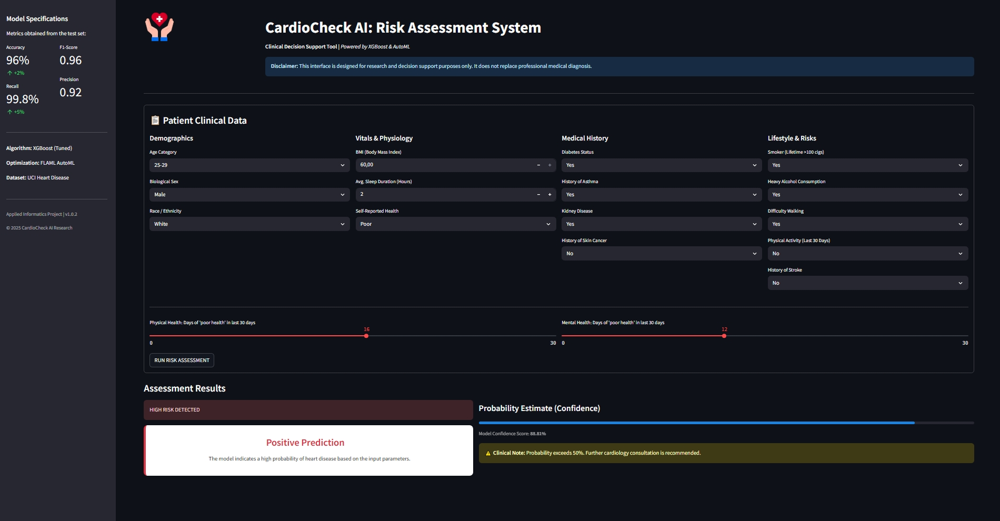
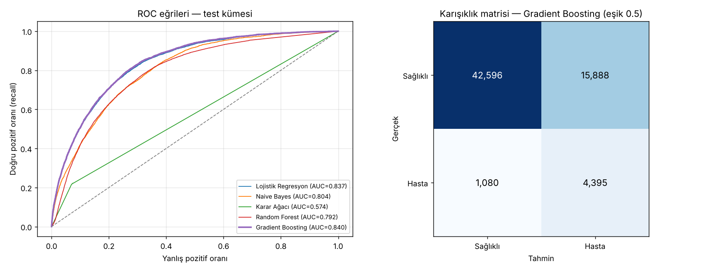

# 🫀 Heart Disease Risk Prediction

[Türkçe](README.md)

A machine-learning project that predicts heart disease risk from the lifestyle and health data of about **320,000 respondents** to the 2020 US health survey (CDC BRFSS). Five classifiers are compared and the best model is served through **CardioCheck AI**, a Streamlit decision-support interface.

> ⚠️ For research and educational purposes only; not a medical diagnostic tool.



## Results

The test set has **63,959 records** that were never used in training and keep the real class distribution (8.6% heart disease).

| Model | ROC-AUC | Recall | Precision | F1 |
| --- | --- | --- | --- | --- |
| **Gradient Boosting** | **0.840** | **0.803** | 0.217 | 0.341 |
| Logistic Regression | 0.837 | 0.773 | 0.224 | 0.347 |
| Naive Bayes | 0.804 | 0.595 | 0.234 | 0.336 |
| Random Forest | 0.792 | 0.214 | 0.302 | 0.250 |
| Decision Tree | 0.574 | 0.223 | 0.214 | 0.218 |

**The best model (Gradient Boosting)** correctly identifies **80%** of people with heart disease. Because the data is imbalanced (about 1 in 12 has the disease), the model accepts a higher false-alarm rate so that it misses fewer patients, which is why precision is low. This is a deliberate trade-off for a screening tool.



## Methodology note: fixing data leakage

In the first version of the project, random oversampling of the minority class was done **before** the train/test split. Copies of the same patient record then end up in both the training and the test set, so the model is tested on records it has memorised. Comparison on the same data:

| Model | Leaky protocol (oversample first) | Correct protocol (split first) |
| --- | --- | --- |
| Decision Tree | ROC-AUC 0.954 · Recall 0.999 | ROC-AUC 0.574 · Recall 0.223 |
| Random Forest | ROC-AUC 0.997 · Recall 0.999 | ROC-AUC 0.792 · Recall 0.214 |

The current pipeline works in this order:
1. Stratified 80/20 train/test split
2. Encoders and scalers are fitted **on the training set only**
3. Random oversampling is applied **to the training set only**
4. Evaluation on the untouched test set with probability-based ROC-AUC and PR-AUC

Tree models look excellent under the leaky protocol and weak under the correct one because they memorise the duplicated records.

## Dataset

[Personal Key Indicators of Heart Disease (Kaggle)](https://www.kaggle.com/datasets/kamilpytlak/personal-key-indicators-of-heart-disease). Source: CDC BRFSS 2020. 319,795 records, 17 features (BMI, smoking, alcohol, stroke history, physical/mental health, age group, diabetes, sleep time, etc.). Not included in the repository because of its size; place `heart_2020_cleaned.csv` in `data/`.

## Setup and usage

```bash
pip install -r requirements.txt

# UI (the trained model is ready in utils/)
streamlit run app.py

# To retrain the models (dataset must be in data/)
python src/train.py
```

`train.py` writes results to `results/` and the model files used by the UI to `utils/`.

## Project structure

```
├── app.py                 CardioCheck AI — Streamlit decision-support UI
├── src/
│   ├── preprocess.py      Encoding and scaling (fit on train, applied to test)
│   └── train.py           Model training, evaluation, plots
├── utils/                 Trained model + preprocessor + summary metrics
├── results/               Model comparison tables and plots
└── data/                  Dataset (not included)
```
