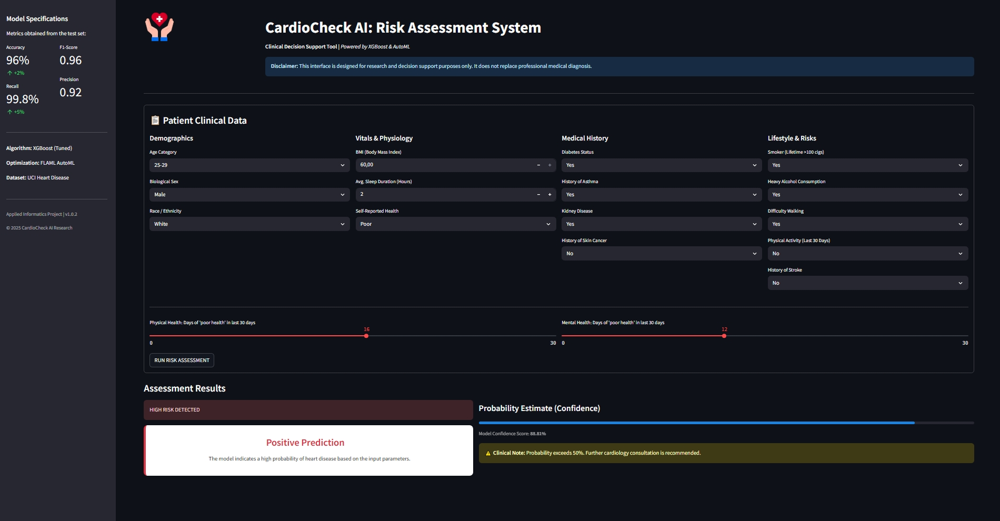
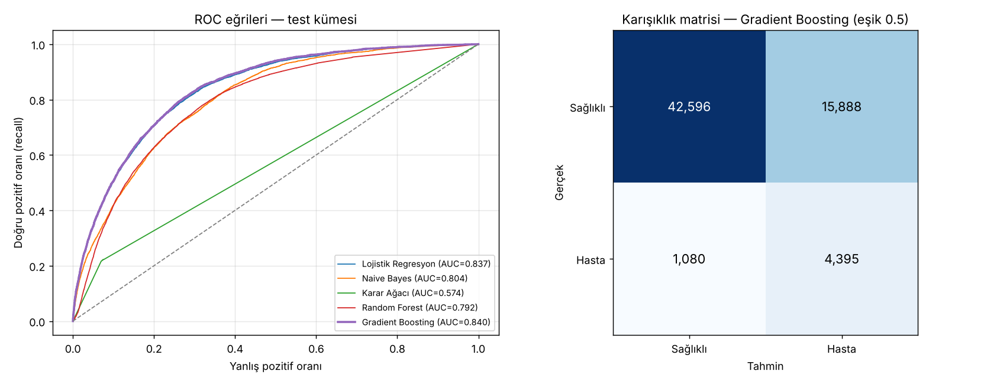

# 🫀 Kalp Hastalığı Risk Tahmini

[English](README.en.md)

ABD'de 2020 yılında yapılan sağlık anketine (CDC BRFSS) katılan yaklaşık **320.000 kişinin** yaşam tarzı ve sağlık verileriyle kalp hastalığı riskini tahmin eden bir makine öğrenmesi projesi. Projede 5 sınıflandırma modeli karşılaştırılır ve en iyi model **CardioCheck AI** adlı Streamlit karar destek arayüzüyle sunulur.

> ⚠️ Araştırma ve eğitim amaçlıdır; tıbbi tanı aracı değildir.



## Sonuçlar

Test kümesi, eğitime hiç girmeyen ve gerçek sınıf dağılımını koruyan **63.959 kayıttan** oluşur (kalp hastalığı oranı %8,6).

| Model | ROC-AUC | Recall | Precision | F1 |
| --- | --- | --- | --- | --- |
| **Gradient Boosting** | **0,840** | **0,803** | 0,217 | 0,341 |
| Lojistik Regresyon | 0,837 | 0,773 | 0,224 | 0,347 |
| Naive Bayes | 0,804 | 0,595 | 0,234 | 0,336 |
| Random Forest | 0,792 | 0,214 | 0,302 | 0,250 |
| Karar Ağacı | 0,574 | 0,223 | 0,214 | 0,218 |

**En iyi model (Gradient Boosting)** kalp hastalığı olan kişilerin **%80'ini** doğru tespit ediyor. Veri dengesiz olduğundan (her 12 kişiden biri hasta), hastaları kaçırmamak için yanlış alarm oranı yüksek tutuluyor; precision bu yüzden düşük. Bu, tarama amaçlı bir araç için bilinçli bir tercih.



## Metodoloji notu: veri sızıntısı düzeltmesi

Projenin ilk sürümünde azınlık sınıfı rastgele çoğaltma (oversampling) eğitim/test ayrımından **önce** yapılıyordu. Bu durumda aynı hasta kaydının kopyaları hem eğitim hem test kümesine düşer ve model, ezberlediği kayıtlar üzerinde sınanmış olur. Aynı verideki karşılaştırma:

| Model | Hatalı protokol (önce çoğaltma) | Doğru protokol (önce ayırma) |
| --- | --- | --- |
| Karar Ağacı | ROC-AUC 0,954 · Recall 0,999 | ROC-AUC 0,574 · Recall 0,223 |
| Random Forest | ROC-AUC 0,997 · Recall 0,999 | ROC-AUC 0,792 · Recall 0,214 |

Güncel sürümde sıralama şöyledir:
1. Katmanlı (stratified) %80/%20 eğitim/test ayrımı
2. Kodlayıcılar ve ölçekleyiciler **yalnızca eğitim kümesine** fit edilir
3. Rastgele çoğaltma **yalnızca eğitim kümesine** uygulanır
4. Değerlendirme dokunulmamış test kümesinde, olasılık tabanlı ROC-AUC ve PR-AUC ile yapılır

Ağaç modellerinin hatalı protokolde bu kadar parlak, doğru protokolde zayıf görünmesi, kopyalanmış kayıtları ezberlemelerinden kaynaklanır.

## Veri seti

[Personal Key Indicators of Heart Disease (Kaggle)](https://www.kaggle.com/datasets/kamilpytlak/personal-key-indicators-of-heart-disease). Kaynak: CDC BRFSS 2020. 319.795 kayıt, 17 özellik (BMI, sigara, alkol, inme geçmişi, fiziksel/ruhsal sağlık, yaş grubu, diyabet, uyku süresi vb.). Dosya boyutu nedeniyle repoya eklenmemiştir. `heart_2020_cleaned.csv` dosyasını `data/` klasörüne koyun.

## Kurulum ve çalıştırma

```bash
pip install -r requirements.txt

# Arayüz (eğitilmiş model utils/ klasöründe hazır)
streamlit run app.py

# Modelleri yeniden eğitmek için (veri seti data/ klasöründe olmalı)
python src/train.py
```

`train.py` sonuçları `results/` klasörüne, arayüzün kullandığı model dosyalarını `utils/` klasörüne yazar.

## Proje yapısı

```
├── app.py                 CardioCheck AI — Streamlit karar destek arayüzü
├── src/
│   ├── preprocess.py      Kodlama ve ölçekleme (eğitime fit, teste uygulanır)
│   └── train.py           Model eğitimi, değerlendirme, grafikler
├── utils/                 Eğitilmiş model + ön işlemci + özet metrikler
├── results/               Model karşılaştırma tabloları ve grafikler
└── data/                  Veri seti (repoya dahil değil)
```
